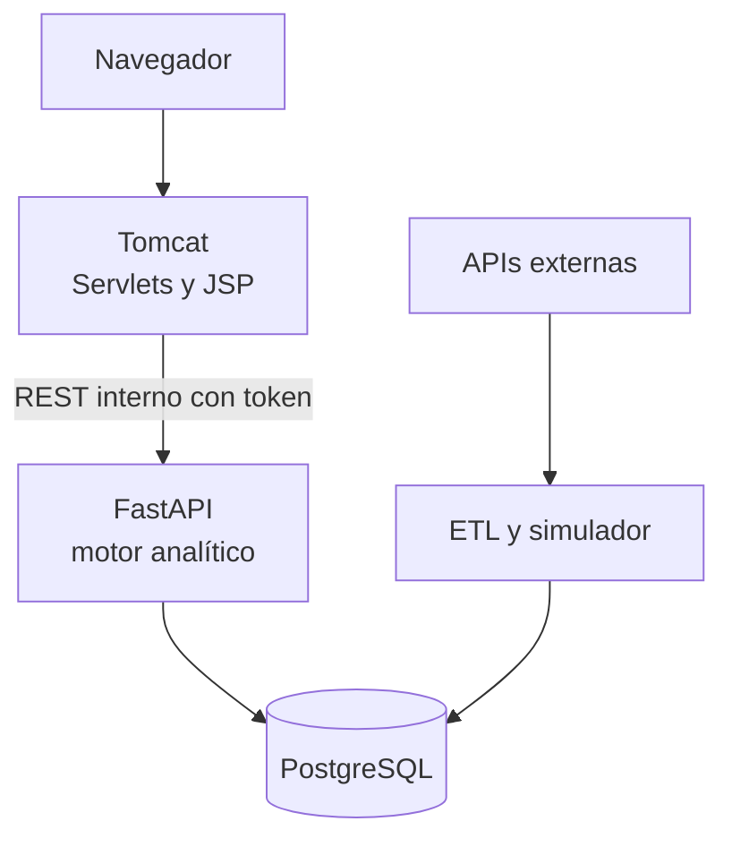

# Dashboard Ejecutivo de Supply Chain

## Qué es

Dashboard ejecutivo para la gestión estratégica de la cadena de suministro (Supply Chain). Consolida información de compras, inventarios, logística, almacenes, transporte y proveedores para ofrecer indicadores ejecutivos en tiempo real, e incorpora inteligencia artificial para detectar desviaciones, identificar riesgos operativos, generar pronósticos y apoyar la toma de decisiones estratégicas.

En una sola pantalla responde **cómo está la cadena y qué hay que atender hoy**: 11 indicadores (KPIs) con meta y estado, alertas cuando un indicador cruza su umbral y soluciones propuestas con su impacto en pesos para que una persona decida.

Proyecto de Residencia Profesional desarrollado por Pamela J. Perez G. en PluriOne S.A. de C.V. (Develop Talent & Technology).

> **Datos:** la operación (órdenes, inventarios, envíos y demanda) es **simulada** con reglas de negocio; no proviene de un ERP real. El tipo de cambio FIX de Banxico y el clima de Open-Meteo son **reales**. La interfaz indica en cada cifra si es simulada o real y su fecha de corte.

---

## Funcionalidad

| Vista | Qué hace |
|---|---|
| **Resumen ejecutivo** | Estado de la cadena en 5 estaciones (Proveedores, Compras, Transporte, Almacenes e Inventario) con KPI, meta, tendencia de 30 días y estado; "Qué atender hoy" con hasta 5 casos ordenados por impacto en MXN; demanda real contra pronóstico con banda de incertidumbre |
| **Compras** | Tipo de cambio FIX real, compras por proveedor, lead time y variación de costo |
| **Inventarios** | Días de cobertura por producto contra mínimo y exceso, rotación, Fill Rate y días de inventario |
| **Logística y transporte** | Puntualidad por ruta, envíos atrasados, clima en ruta y costo de flete |
| **Almacenes** | Utilización diaria de cada almacén contra su máximo |
| **Proveedores** | OTIF e índice de riesgo 0-100 con sus componentes |
| **Centro de soluciones** | Cada problema detectado con evidencia en gráfica, opciones comparadas por costo total esperado, confianza del modelo, plan de acción y ahorro real contra proyectado |
| **Asistente de IA** | Chat de solo lectura que responde con cifras consultadas al motor analítico y cita la fecha de corte |
| **Alertas ejecutivas** | Indicadores fuera de meta e historial de alertas en vivo |
| **Administración** | Consulta de usuarios y roles (sin contraseñas) |

**Modelos analíticos:**
- Pronóstico de demanda Holt-Winters con estacionalidad semanal, medido con MAPE (3.3 %).
- Detección de anomalías con Isolation Forest, validado contra eventos inyectados con resultado conocido.
- Índice de riesgo de proveedor de 0 a 100 (retrasos, cumplimiento y concentración de gasto).
- Motor de recomendaciones que compara opciones por costo total esperado.

**Simulador en vivo:** genera la operación día por día con las mismas reglas de negocio y la muestra en tiempo real (Server-Sent Events).

## Detalles importantes

- **La IA recomienda; las personas deciden.** El sistema nunca ejecuta compras ni cambia estados por sí mismo. En el Centro de soluciones una persona aprueba, descarta con motivo o cierra con el ahorro real, y cada decisión queda en el historial.
- **Roles:** EJECUTIVO decide sobre los casos, OPERACIONES marca los pasos del plan de acción y ADMIN administra usuarios. El rol se valida en el servidor en cada operación.
- **Seguridad:** contraseñas cifradas con PBKDF2 (600,000 iteraciones), bloqueo tras 5 intentos fallidos, sesión con cookie `HttpOnly` y `SameSite=Strict`, protección CSRF, política de seguridad de contenido y bibliotecas con hash de integridad. El navegador solo habla con Tomcat; el motor analítico escucha solo en la máquina local y exige un token interno.
- **Sin secretos en el repositorio:** las contraseñas, tokens y llaves se configuran localmente en cada instalación y nunca se versionan; el repositorio solo incluye una plantilla con los valores vacíos. El código no contiene usuarios ni contraseñas; las cuentas se crean en consola.
- **Costo $0:** todo corre en la máquina local, con APIs y modelos de IA gratuitos.
- **Verificado:** 41 de 41 pruebas de calidad, 23 de 23 validaciones de KPIs en SQL y 21 de 21 pruebas de seguridad y 55 pruebas automáticas que se repiten con `python -m pytest` (ver [`docs/REPORTE_QA.md`](docs/REPORTE_QA.md)).

## Arquitectura



## Versiones utilizadas

| Componente | Software | Versión |
|---|---|---|
| Base de datos | PostgreSQL | 18.6 |
| Motor analítico | Python | 3.13.15 |
| | FastAPI (`fastapi[standard]`) | 0.135.1 |
| | psycopg2-binary | 2.9.10 |
| | pandas | 3.0.6 |
| | statsmodels | 0.15.0 |
| | numpy | 2.5.3 |
| | scipy | 1.18.1 |
| Capa web | JDK (Eclipse Temurin, LTS) | 21.0.12.1 |
| | Apache Tomcat | 10.1.60 |
| | Bootstrap | 5.3.8 |
| | Chart.js | 4.5.1 |
| Entorno | Windows con PowerShell | 5.1 |
| | Visual Studio Code y Git | Última estable |

Todas las dependencias de Python están fijadas en [`backend/requirements.txt`](backend/requirements.txt). La capa web no usa Maven ni bibliotecas Java externas.

**Servicios externos (planes gratuitos):** Banxico SIE (tipo de cambio FIX), Open-Meteo (clima), ExchangeRate-API (tasa diaria), DummyJSON (catálogo de productos) y Z.AI GLM-4.7-Flash y GLM-4.5-Flash (asistente).

## Cómo levantar el programa

La primera vez se instala con un solo comando; después solo se arrancan dos servicios. Cada paso del instalador se describe, también para hacerlo a mano, en el [manual técnico](docs/MANUAL_TECNICO.md), sección 5.

### Primera vez

1. Instalar las versiones de la tabla anterior. Definir `CATALINA_HOME` con la carpeta de Tomcat y `JAVA_HOME` con la del JDK 21.
2. Desde la raíz del proyecto:

```powershell
powershell -ExecutionPolicy Bypass -File .\instalar.ps1
```

El instalador:
- pide sin mostrarlas la contraseña de PostgreSQL y la de cada cuenta (`gerencia`, `operaciones` y `admin`);
- crea `backend\.env` a partir de `.env.example` si no existe;
- crea la base `supply_chain_final` y carga los datos;
- compila la capa web y termina con la verificación.

El token de Banxico y la llave de Z.AI son opcionales (ver [Funcionamiento sin llaves](#funcionamiento-sin-llaves)). Usa los datos de respaldo validados, así que reproduce exactamente los 12 meses del proyecto. Para probarlo sin tocar una instalación existente: `powershell -ExecutionPolicy Bypass -File .\instalar.ps1 -BaseDatos supply_chain_prueba -SinWeb`.

### Pruebas automáticas

Desde la carpeta `backend`, con el entorno virtual activo; no requieren PostgreSQL ni llaves:

```powershell
python -m pytest
```

Resultado esperado: 55 de 55 (CC-26).

### Cada vez que se usa

Motor analítico, desde la carpeta `backend`:

```powershell
.\.venv\Scripts\Activate.ps1
fastapi dev app/main.py
```

Servidor web, en otra ventana:

```powershell
& "$env:CATALINA_HOME\bin\startup.bat"
```

Abrir `http://localhost:8080/supplychain/` e iniciar sesión con una de las cuentas creadas al instalar.

Opcional, para ver eventos en vivo (carpeta `backend`, entorno virtual activo):

```powershell
python -m etl.simulador_vivo --dias 1
```

Para regresar los datos a su estado base: `python -m etl.simulador_vivo --reiniciar`.

## Funcionamiento sin llaves

El sistema se instala y se revisa sin ninguna llave externa. Los datos externos con que se validaron los 12 meses están versionados en [`backend/etl/respaldo`](backend/etl/respaldo/LEEME.md); los ETL los usan si falta la llave, si la API no responde o con `--respaldo`, y lo indican con un aviso en la consola. Con el respaldo, `python -m etl.generar_operacion --huella` da la misma huella de datos que la base validada (`efe7c9c4...`, prueba AUT-02).

| Componente | Sin llave o sin conexión | Qué se ve en el dashboard |
|---|---|---|
| Catálogo de productos (DummyJSON) | `etl.cargar_productos` carga `respaldo/productos.csv` con los mismos identificadores | Los mismos 12 productos |
| Tipo de cambio FIX (Banxico SIE, `BANXICO_TOKEN`) | `etl.cargar_banxico` carga los 251 días de `respaldo/banxico_fix_sf43718.csv` | Las mismas cifras; la fuente sigue siendo Banxico SIE |
| Clima histórico (Open-Meteo) | `etl.descargar_clima` copia `respaldo/clima` a la caché local | Los mismos retrasos por clima |
| Tasa del día (ExchangeRate-API) | `etl.cargar_tipo_cambio` falla con error de conexión; se puede omitir | Compras muestra solo el FIX de Banxico |
| Asistente de IA (Z.AI, `ZAI_API_KEY`) | Intenta Ollama si está instalado; si no, responde que no está disponible | Aviso "El asistente no está disponible"; el resto del dashboard funciona |
| Simulador en vivo (pronóstico de Open-Meteo) | Usa la caché anterior o clima despejado (CC-22) | Los eventos en vivo siguen |

## Uso de herramientas de IA

Este proyecto se desarrolló con apoyo de inteligencia artificial. Se declara aquí qué herramienta se usó, para qué y quién tomó cada decisión.

### Como herramienta de desarrollo

| Herramienta | Uso | Decisión y verificación |
|---|---|---|
| Claude Opus 5.5 (Anthropic) | Redacción del PDR, el PRD y el alcance del MVP | La desarrolladora definió el problema, el alcance y los requisitos, y aprobó cada documento |
| Claude Opus 5.5 (Anthropic) | Propuesta de código de Python, SQL, Java, JSP, JavaScript y PowerShell | La desarrolladora pegó, ejecutó y verificó cada archivo en su equipo; lo que no le convenció lo indicó y se rehízo |
| Claude Opus 5.5 (Anthropic) | Diagnóstico y corrección de errores | Cada corrección la aprobó o la rechazó la desarrolladora antes del commit |
| Claude Opus 5.5 (Anthropic) | Redacción de la documentación (manual técnico, plan de mantenimiento, control de cambios, reporte QA y mensajes de commit) | Los textos se redactaron a partir de lo que la desarrolladora ejecutó y revisó; la bitácora se genera desde `git log` |

Decisiones tomadas por la desarrolladora, sin propuesta de la IA:
- el stack (PostgreSQL, FastAPI, Java Servlets y JSP sobre Tomcat);
- las herramientas de desarrollo;
- las APIs externas (DummyJSON, Open-Meteo, ExchangeRate-API, Banxico SIE y Z.AI).

La desarrolladora aprobó cada cambio respecto al PDR (`docs/CONTROL_DE_CAMBIOS.md`). Todas las pruebas, capturas y salidas de consola de `docs/qa/` se obtuvieron en su equipo.

### Como componente del producto

El asistente del módulo de inteligencia artificial (CC-17) usa los modelos gratuitos GLM-4.7-Flash y GLM-4.5-Flash de Z.AI, con Ollama como respaldo local opcional. Es de solo lectura y sus cifras salen de consultas a los endpoints del motor analítico; nunca aprueba, descarta ni cambia datos.

## Estructura del repositorio

```text
backend/    API FastAPI (app), modelos (analitica), ETL y simulador (etl), administración (admin)
db/final/   scripts SQL del esquema, extensiones y validación de KPIs
frontend/   Servlets Java (src), vistas JSP, JavaScript y CSS (webapp), build.ps1
docs/       documentación del proyecto y evidencia de pruebas
```

## Documentación

| Documento | Contenido |
|---|---|
| [Manual técnico](docs/MANUAL_TECNICO.md) | Arquitectura, instalación, operación, rutas, seguridad y guía por rol |
| [Guía de capacitación](docs/GUIA_CAPACITACION.md) | Ejercicios por rol y formato de acta |
| [Plan de mantenimiento](docs/PLAN_MANTENIMIENTO.md) | Soporte multinivel, tareas preventivas y fallas conocidas |
| [Reporte QA](docs/REPORTE_QA.md) | 41 pruebas con evidencia en `docs/qa/` |
| [Matriz de trazabilidad](docs/MATRIZ_TRAZABILIDAD.md) | Relación entre el diseño, la implementación y la evidencia |
| [Control de cambios](docs/CONTROL_DE_CAMBIOS.md) | Decisiones que precisan o extienden el diseño de referencia |
| [Bitácora](docs/BITACORA.md) | Historial de commits |

## Versiones del proyecto

- Rama `proyecto-final`: versión final.
- Etiqueta `mvp-v1.0` en `master`: MVP congelado.

## Fuentes de datos y atribuciones

- Tipo de cambio FIX: [Banco de México, SIE](https://www.banxico.org.mx/SieAPIRest/service/v1/) (serie SF43718).
- Clima: [Open-Meteo](https://open-meteo.com/), datos bajo licencia CC BY 4.0.
- Tasa de cambio diaria: [Rates By Exchange Rate API](https://www.exchangerate-api.com).
- Catálogo de productos de muestra: [DummyJSON](https://dummyjson.com/).