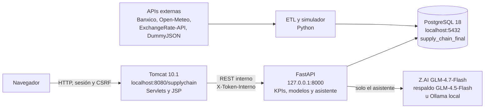

# Manual técnico

**Proyecto:** Dashboard Ejecutivo de Supply Chain
**Empresa:** PluriOne S.A. de C.V. (Develop Talent & Technology)
**Documento de referencia:** PDR-SCM-2026-001 v1.0, Fase 7 (Documentación técnica y de usuario)
**Versión del sistema:** rama `proyecto-final`, funcionalidad congelada el 15 de octubre de 2026
**Desarrolladora:** Pamela Jhatdzarhy Perez Gomez

Este manual explica cómo está construido el sistema, cómo se instala desde cero, cómo se opera cada día y cómo lo usa cada rol. Las decisiones que extienden o precisan el PDR están en `docs/CONTROL_DE_CAMBIOS.md` (CC-01 a CC-24); aquí se citan por su número. Las pruebas están en `docs/REPORTE_QA.md`.

---

## 1. Arquitectura

El sistema sigue la arquitectura de tres capas del PDR (sección 5): presentación y aplicación en Java, motor analítico en Python y datos en PostgreSQL. Todo corre en la máquina local, sin costo (PDR 4.1).



| Componente | Tecnología | Dirección | Responsabilidad |
|---|---|---|---|
| Presentación y aplicación | JSP, JavaScript sin frameworks, Bootstrap 5.3.8, Chart.js 4.5.1, Servlets sobre Tomcat 10.1.60 con JDK 21 | `http://localhost:8080/supplychain/` | Vistas, sesión, roles, CSRF, lista blanca de rutas y orquestación de llamadas a FastAPI |
| Motor analítico | Python 3.13.15, FastAPI 0.135.1, pandas, statsmodels, numpy | `http://127.0.0.1:8000` | KPIs, pronóstico, riesgo, anomalías, recomendaciones, actividad en vivo y asistente de IA |
| Datos | PostgreSQL 18.6 | `localhost:5432`, base `supply_chain_final` | Esquema operacional y modelo estrella del PDR más las extensiones de los CC |
| Ingesta | Scripts Python en `backend/etl` | Ejecución manual o continua | Carga de catálogos y tipo de cambio, clima, 12 meses de operación simulada y simulador en vivo |

**Reglas de la arquitectura:**
- El navegador solo habla con Tomcat. FastAPI escucha únicamente en 127.0.0.1, no tiene CORS y toda ruta exige la cabecera `X-Token-Interno` (CC-21).
- La analítica corre en lote: los scripts de `backend/analitica` escriben sus resultados en la base y los endpoints solo los leen, lo que mantiene rápida la carga del dashboard.
- La IA solo recomienda, explica y da seguimiento. Una persona aprueba, descarta o cierra cada caso (PDR sección 2, CC-19).
- Los datos operativos son simulados con reglas de negocio. El tipo de cambio FIX de Banxico y el clima de Open-Meteo son reales. La interfaz indica en cada cifra si es simulada o real.

---

## 2. Estructura del repositorio

```text
supply-chain-dashboard/
├── backend/
│   ├── admin/          crear_usuario.py, token_interno.py, verificar_seguridad.py
│   ├── analitica/      pronostico.py, riesgo.py, anomalias.py, iforest.py, recomendaciones.py
│   ├── app/            main.py y routers de FastAPI (kpis, pronostico, riesgo, recomendaciones,
│   │                   asistente, actividad, modulos, auth), seguridad.py, database.py
│   ├── etl/            cargar_productos.py, cargar_tipo_cambio.py, cargar_banxico.py,
│   │                   descargar_clima.py, generar_operacion.py, simulador_vivo.py
│   │   └── datos/      config_simulacion.json, eventos_inyectados.json, volumen_por_sku.json
│   └── requirements.txt
├── db/
│   ├── final/          01 a 07 (esquema y extensiones), 99_verificar_extensiones.sql, validar_kpis.sql
│   └── schema.sql      esquema del MVP (etiqueta mvp-v1.0), no se usa en el proyecto final
├── frontend/
│   ├── build.ps1       compila y despliega en Tomcat
│   ├── src/mx/com/develop/supplychain/
│   │   ├── filtro/     SeguridadFiltro
│   │   ├── servicio/   FastApiCliente, CentralEventos, Json
│   │   ├── util/       Html
│   │   └── web/        Servlets
│   └── webapp/         JSP, js, css, WEB-INF/web.xml
└── docs/               CONTROL_DE_CAMBIOS.md, REPORTE_QA.md, project_state.json, BITACORA.md, qa/
```

**No se versionan** (`.gitignore`): `backend/.env`, `setenv.bat` de Tomcat, `backend/.venv`, `backend/etl/cache/`, `frontend/build/`, `.vscode/`, el PDR y los documentos internos de la empresa (CC-12).

---

## 3. Requisitos

| Software | Versión | Notas |
|---|---|---|
| Windows | 10 u 11 | PowerShell 5.1 |
| PostgreSQL | 18.6 | `psql` en el PATH del usuario |
| Python | 3.13.15 | Entorno virtual en `backend\.venv` |
| JDK | Temurin 21.0.12.1 (LTS) | `JAVA_HOME` apuntando al JDK 21 |
| Apache Tomcat | 10.1.60 (zip) | En `C:\tomcat\apache-tomcat-10.1.60`, con `CATALINA_HOME` |
| Git | Última estable | |
| Navegador | Chrome o Edge actualizado | |

Las versiones exactas de Python están fijadas en `backend/requirements.txt` (PDR 4.3, CC-13). La capa web no usa Maven ni bibliotecas externas: compila con el `javac` del JDK contra `servlet-api.jar` de Tomcat.

Llaves gratuitas necesarias:
- Token de Banxico SIE (serie SF43718, tipo de cambio FIX).
- Llave de Z.AI para el asistente (modelos gratuitos GLM-4.7-Flash y GLM-4.5-Flash).

---

## 4. Configuración

### 4.1 `backend\.env`

Archivo de texto en UTF-8 sin acentos, fuera del repositorio. Variables:

| Variable | Uso |
|---|---|
| `DB_HOST` | Servidor de PostgreSQL (`localhost`) |
| `DB_PORT` | Puerto (`5432`) |
| `DB_NAME` | Base del proyecto final (`supply_chain_final`) |
| `DB_USER` | Usuario de PostgreSQL |
| `DB_PASSWORD` | Contraseña de PostgreSQL, sin acentos ni símbolos especiales |
| `BANXICO_TOKEN` | Token de Banxico SIE |
| `ZAI_API_KEY` | Llave de Z.AI |
| `SC_TOKEN_INTERNO` | Token del canal Tomcat-FastAPI; lo escribe `python -m admin.token_interno` |

Opcionales para el respaldo local del asistente: `OLLAMA_URL` (por defecto `http://localhost:11434/v1/chat/completions`) y `OLLAMA_MODELO` (por defecto `qwen2.5:7b`).

### 4.2 `C:\tomcat\apache-tomcat-10.1.60\bin\setenv.bat`

Lo escribe `python -m admin.token_interno` junto con `.env`. Define:
- `SC_TOKEN_INTERNO`: el mismo token que en `.env`.
- `SC_FASTAPI_URL=http://127.0.0.1:8000`: se usa 127.0.0.1 y no `localhost` para que Java no intente IPv6.

Los valores nunca se muestran en consola ni se copian a la documentación. Si el token falta o no coincide, FastAPI responde 401 a Tomcat, o 503 si no tiene token configurado (falla cerrada).

---

## 5. Instalación desde cero

Todos los comandos se ejecutan en PowerShell. Se indica la carpeta en cada bloque.

### 5.1 Entorno de Python (carpeta `backend`)

```powershell
python -m venv .venv
.\.venv\Scripts\Activate.ps1
pip install -r requirements.txt
```

Después se crea `backend\.env` con las variables de la sección 4.1, excepto `SC_TOKEN_INTERNO`.

### 5.2 Base de datos (raíz del proyecto)

Se crea la base y se ejecutan los scripts en este orden. Cada script es aditivo e idempotente.

```powershell
psql -U postgres -c "CREATE DATABASE supply_chain_final ENCODING 'UTF8'"
psql -U postgres -d supply_chain_final -f db\final\01_esquema_pdr.sql
psql -U postgres -d supply_chain_final -f db\final\02_centro_soluciones.sql
psql -U postgres -d supply_chain_final -f db\final\03_extensiones_modelo.sql
psql -U postgres -d supply_chain_final -f db\final\99_verificar_extensiones.sql
psql -U postgres -d supply_chain_final -f db\final\05_asistente.sql
psql -U postgres -d supply_chain_final -f db\final\06_usuarios.sql
```

`99_verificar_extensiones.sql` debe reportar 36 de 36 pruebas correctas.

### 5.3 Carga de datos (carpeta `backend`, entorno virtual activo)

```powershell
python -m etl.cargar_productos
python -m etl.cargar_tipo_cambio
python -m etl.cargar_banxico
python -m etl.descargar_clima
python -m etl.generar_operacion
```
Sin token de Banxico o sin conexión a DummyJSON, Banxico u Open-Meteo, los tres primeros pasos cargan los datos de respaldo de `backend/etl/respaldo` y lo indican con un aviso; con `--respaldo` se usan sin intentar la descarga (CC-27). `cargar_tipo_cambio` solo trae la tasa del día y se puede omitir sin conexión.

`generar_operacion` usa una semilla fija: siempre genera los mismos 12 meses (395 órdenes, 401 renglones y 13,140 registros de demanda diaria). `python -m etl.generar_operacion --huella` imprime la huella SHA-256 de los datos sin escribir en la base; debe ser `efe7c9c4...` (CC-22).

### 5.4 Modelo estrella y simulador en vivo (raíz del proyecto)

```powershell
psql -U postgres -d supply_chain_final -f db\final\04_agregacion_fact.sql
psql -U postgres -d supply_chain_final -f db\final\07_simulador_vivo.sql
```

### 5.5 Modelos analíticos (carpeta `backend`, entorno virtual activo)

El orden importa: Isolation Forest escribe sobre el modelo estrella y el motor de recomendaciones usa el pronóstico y el riesgo.

```powershell
python -m analitica.pronostico
python -m analitica.riesgo
python -m analitica.anomalias
python -m analitica.recomendaciones
```

### 5.6 Token interno y usuarios (carpeta `backend`, entorno virtual activo)

```powershell
python -m admin.token_interno
python -m admin.crear_usuario
```

`crear_usuario` pide la contraseña oculta (de 15 a 128 caracteres, sin el nombre de usuario). Se crean tres usuarios, uno por rol: `gerencia` (EJECUTIVO), `operaciones` (OPERACIONES) y `admin` (ADMIN). Las contraseñas se guardan en un gestor de contraseñas, nunca en el repositorio.

### 5.7 Capa web (raíz del proyecto)

```powershell
.\frontend\build.ps1
```

Compila las clases con `javac --release 21 -Xlint:all` y despliega `frontend/webapp` en `webapps\supplychain` de Tomcat con `robocopy /MIR`. Se ejecuta después de cada cambio en Java, JSP, JavaScript o CSS.

### 5.8 Verificación de la instalación

```powershell
psql -U postgres -h localhost -d postgres -P pager=off -v vol_b64=$vol -f db\final\validar_kpis.sql
```

`$vol` se prepara antes, desde la raíz, con `$vol = [Convert]::ToBase64String([IO.File]::ReadAllBytes((Resolve-Path "backend\etl\datos\volumen_por_sku.json")))`. El resultado esperado es 23 de 23 correctas. Con FastAPI levantado, `python -m admin.verificar_seguridad` (carpeta `backend`) debe dar 21 de 21 con 26 rutas.

---

## 6. Operación diaria

### 6.1 Arranque

1. PostgreSQL arranca como servicio de Windows; no requiere acción.
2. FastAPI, en una ventana dedicada (carpeta `backend`, entorno virtual activo): `fastapi dev app/main.py`.
3. Tomcat, en otra ventana: `C:\tomcat\apache-tomcat-10.1.60\bin\startup.bat`.
4. Abrir `http://localhost:8080/supplychain/` e iniciar sesión.

### 6.2 Apagado

1. Tomcat: `C:\tomcat\apache-tomcat-10.1.60\bin\shutdown.bat`.
2. FastAPI: Ctrl+C en su ventana.
3. Simulador en vivo, si está corriendo: Ctrl+C. Retoma donde se quedó en la siguiente ejecución.

### 6.3 Simulador en vivo (CC-09 y CC-22)

Se ejecuta desde la carpeta `backend` con el entorno virtual activo.

| Comando | Efecto |
|---|---|
| `python -m etl.simulador_vivo` | Simula desde el último día cerrado hasta el día anterior a la fecha real, con pausas de 10 a 30 segundos entre eventos, y espera el día siguiente |
| `python -m etl.simulador_vivo --dias N` | Simula N días y termina |
| `python -m etl.simulador_vivo --sin-espera` | Sin pausas (pruebas) |
| `python -m etl.simulador_vivo --estado` | Muestra el día cerrado y el día en curso |
| `python -m etl.simulador_vivo --reiniciar` | Regresa exactamente a la base del 30 de septiembre de 2026 |

Al cerrar cada día, el simulador actualiza el modelo estrella y vuelve a correr el pronóstico, el riesgo y las recomendaciones. Solo puede correr uno a la vez (`pg_advisory_lock`).

### 6.4 Preparación de una demostración

1. `python -m etl.simulador_vivo --reiniciar`, para partir de la base validada.
2. Arrancar FastAPI y Tomcat, e iniciar sesión con `gerencia`.
3. `python -m etl.simulador_vivo --dias 1` para mostrar eventos en vivo. El día 1 es determinista: ENV-0391 llega 2 días tarde y la estación de Proveedores pasa a Crítico con OTIF de 79.3 %.
4. Al terminar, `python -m etl.simulador_vivo --reiniciar`.

---

## 7. Catálogo de rutas

### 7.1 Tomcat (`/supplychain`)

Todas las rutas, salvo el login, exigen sesión. El filtro `SeguridadFiltro` agrega las cabeceras de seguridad y valida el token CSRF en todo POST.

| Ruta | Servlet | Método | Rol |
|---|---|---|---|
| `/login`, `/logout` | `LoginServlet`, `LogoutServlet` | GET, POST | Público el login |
| `/resumen`, `/soluciones`, `/asistente`, `/actividad` | `PaginaServlet` | GET | Todos |
| `/compras`, `/inventarios`, `/logistica`, `/almacenes`, `/proveedores`, `/alertas` | `PaginaServlet` (plantilla `modulo.jsp`, CC-24) | GET | Todos |
| `/administracion` | `PaginaServlet` | GET | ADMIN; los demás regresan al Resumen |
| `/api/*` | `ApiLecturaServlet` | GET | Todos; solo rutas de la lista blanca |
| `/api/decisiones/*` | `DecisionServlet` | POST | Aprobar, descartar y cerrar: EJECUTIVO. Marcar paso del plan: EJECUTIVO y OPERACIONES |
| `/api/asistente/mensajes` | `AsistenteServlet` | POST | Todos |
| `/api/eventos` | `EventosServlet` (asíncrono, Server-Sent Events) | GET | Todos |
| `/api/admin/usuarios` | `AdminServlet` | GET | ADMIN; 403 a los demás |

Lista blanca de `ApiLecturaServlet` (se reenvía a `/api/v1` de FastAPI con los parámetros validados): `/kpis`, `/estaciones`, `/pronostico?producto_id=`, `/proveedores/riesgo`, `/anomalias`, `/anomalias/evaluacion`, `/recomendaciones?vista=&modulo=`, `/recomendaciones/atender-hoy`, `/recomendaciones/{id}`, `/asistente/sugerencias`, `/asistente/estado`, `/asistente/conversaciones`, `/asistente/conversaciones/{id}` (con el usuario de la sesión), `/actividad/resumen`, `/actividad?limite=&antes_id=&solo_alertas=` y `/modulos/(compras|inventarios|logistica|almacenes)`. Una ruta fuera de la lista responde 404.

### 7.2 FastAPI (`127.0.0.1:8000`, 26 rutas)

Todas exigen `X-Token-Interno`. La documentación OpenAPI se consulta en `http://127.0.0.1:8000/docs`, también con la cabecera (PDR 5.3).

| Router | Rutas |
|---|---|
| `main.py` | `GET /` |
| `auth_api.py` | `POST /api/v1/auth/login` |
| `kpis.py` | `GET /api/v1/kpis`, `GET /api/v1/estaciones` |
| `pronostico_api.py` | `GET /api/v1/pronostico` |
| `riesgo_api.py` | `GET /api/v1/proveedores/riesgo`, `GET /api/v1/anomalias`, `GET /api/v1/anomalias/evaluacion` |
| `recomendaciones_api.py` | `GET /api/v1/recomendaciones`, `GET .../atender-hoy`, `GET .../{rid}`, `POST .../{rid}/decision`, `POST .../{rid}/acciones/{accion_id}/hecha` |
| `asistente_api.py` | `POST /api/v1/asistente/mensajes`, `GET .../conversaciones`, `GET .../conversaciones/{id}`, `GET .../sugerencias`, `GET .../estado` |
| `actividad_api.py` | `GET /api/v1/actividad/resumen`, `GET /api/v1/actividad`, `GET /api/v1/actividad/flujo` (NDJSON) |
| `modulos_api.py` | `GET /api/v1/modulos/compras`, `.../inventarios`, `.../logistica`, `.../almacenes`, `GET /api/v1/admin/usuarios` |

---

## 8. Seguridad

| Control | Implementación | Referencia |
|---|---|---|
| Contraseñas | PBKDF2-HMAC-SHA256 con 600,000 iteraciones, sal de 16 bytes y normalización NFKC; de 15 a 128 caracteres | CC-20, riesgo R7 |
| Intentos fallidos | Bloqueo de 15 minutos al quinto intento consecutivo (429 con `Retry-After`); mismo mensaje y tiempo para usuario inexistente o contraseña incorrecta | CC-20 |
| Sesión | 30 minutos, solo por cookie, `HttpOnly` y `SameSite=Strict`; cambio de identificador al entrar | CC-20 |
| Roles | Se validan en cada Servlet; usuario y rol salen de la sesión, nunca del navegador | CC-20, CC-21 |
| CSRF | Token por sesión en todo POST; sin token responde 403 | CC-20 |
| Cabeceras | CSP sin scripts ni estilos en línea, `X-Frame-Options: DENY`, `nosniff`, `no-store` | CC-20 |
| XSS | Los datos se insertan con `textContent` o nodos, nunca `innerHTML`; en JSP se escapan con `sc:esc` | CC-20 |
| Canal interno | FastAPI solo en 127.0.0.1, sin CORS, con `X-Token-Interno` y falla cerrada | CC-21 |
| Bibliotecas externas | Bootstrap y Chart.js con versión exacta y hash de integridad SHA-256 | PDR 4.3 |
| Secretos | Solo en `.env` y `setenv.bat`, fuera del repositorio | CC-12 |

**Límite conocido:** el entorno es HTTP local, por lo que la cookie no lleva `Secure`. Un despliegue real requiere HTTPS y cookie `Secure` (CC-20).

---

## 9. Modelo de datos

La base `supply_chain_final` contiene:
- Las 11 tablas del PDR (sección 8): `proveedores`, `productos`, `almacenes`, `ordenes_compra`, `detalle_orden_compra`, `movimientos_inventario`, `envios`, `tipo_cambio`, `fact_supply_chain`, `dim_tiempo` y `forecast_demanda`.
- Las extensiones de los CC:
  - `recomendaciones` y `plan_acciones` (CC-01);
  - `demanda_diaria` y columnas de trazabilidad (CC-02);
  - `asistente_conversaciones` y `asistente_mensajes` (CC-17);
  - `usuarios` (CC-20);
  - `eventos_vivo` y `simulador_estado` (CC-22).
- Las vistas `dim_producto`, `dim_proveedor` y `dim_almacen`, que completan el modelo estrella (CC-02).

Funciones:
- `refrescar_modelo_estrella()` recalcula `dim_tiempo` y `fact_supply_chain`.
- `refrescar_modelo_estrella_desde(fecha)` hace la actualización incremental del simulador y conserva `score_anomalia`.
- `reiniciar_simulador_vivo()` regresa a la base.

Los textos se guardan en ASCII, sin acentos ni ñ (CC-11). La interfaz restaura la ortografía con el diccionario de `js/comun.js`.

---

## 10. Modelos analíticos

| Modelo | Script | Método | Resultado validado |
|---|---|---|---|
| KPIs | `app/kpis.py` | 11 KPIs del PDR con las definiciones de CC-15, metas y umbrales de CC-16 y estado evaluado sobre el valor publicado (CC-23) | Idénticos a `validar_kpis.sql` (23 de 23) |
| Pronóstico de demanda | `analitica/pronostico.py` | Holt-Winters aditivo con tendencia amortiguada y estacionalidad semanal; validación con los últimos 28 días, horizonte de 14 e intervalo de 90 % | MAPE total de 3.3 % |
| Riesgo de proveedor | `analitica/riesgo.py` | Score 0-100: retrasos 45 %, cumplimiento 30 % y concentración 25 %, ventana de 90 días | Índice de la red de 30.2 |
| Anomalías | `analitica/anomalias.py`, `iforest.py` | Isolation Forest con implementación propia en numpy (CC-18), validado contra eventos inyectados | Compras: F1 0.27; caída de demanda detectada a los 3 días |
| Recomendaciones | `analitica/recomendaciones.py` | Seis reglas; opciones comparadas por costo total esperado con los supuestos de CC-19 | 4 casos con 351,723 MXN en juego al corte base |
| Asistente | `app/asistente_api.py` | Llamada a herramientas de solo lectura sobre los endpoints; Z.AI GLM-4.7-Flash, luego GLM-4.5-Flash, luego Ollama; 35 s por modelo y 100 s por mensaje; 8 mensajes por minuto por usuario | Cifras iguales a los endpoints (QA IA-02) |

Al corte base, los parámetros y resultados de cada recomendación quedan en su evidencia JSONB para que sean auditables.

---

## 11. Guía de uso por rol

### 11.1 Todos los roles

- **Resumen ejecutivo** (`/resumen`):
  - Estado de la cadena: 5 estaciones con KPI, meta, minigráfica de 30 días y estado. Un clic lleva al módulo de cada una.
  - Qué atender hoy: hasta 5 casos ordenados por impacto en MXN.
  - Demanda y pronóstico: con banda de incertidumbre y MAPE.
  - La franja inferior muestra el último evento en vivo; "Ver actividad" abre el historial.
- **Módulos:** cada uno muestra sus indicadores (las mismas cifras del Resumen), una gráfica principal, una tabla de detalle y los casos abiertos de ese módulo. Se actualizan cada 60 segundos con la pestaña visible.
- **Asistente de IA** (`/asistente`):
  - Responde preguntas con cifras consultadas al motor y cita la fecha de corte.
  - Indica qué modelo respondió.
  - Es de solo lectura: no aprueba ni cambia nada.
- **Estados:** En meta (verde), Atención (ámbar), Crítico (rojo) e Informativo. Siempre se muestran con texto o ícono además del color.

### 11.2 EJECUTIVO (`gerencia`)

En el Centro de soluciones (`/soluciones`):
1. **Abiertas:** revisa la evidencia, las opciones con su costo total esperado, la confianza y el plan.
2. **Aprobar opción elegida:** registra la decisión y el caso pasa a En curso.
3. **Descartar:** exige un motivo de 5 a 300 caracteres.
4. **Cerrar con ahorro real:** registra el ahorro obtenido. El indicador compara el ahorro real contra el proyectado.

Cada decisión queda en el historial del caso con usuario y fecha.

### 11.3 OPERACIONES (`operaciones`)

- Consulta el dashboard y el Centro de soluciones sin botones de decisión.
- En los casos En curso marca como hechos los pasos del plan. El historial registra su usuario y el número de paso.

### 11.4 ADMIN (`admin`)

- **Administración** (`/administracion`) lista los usuarios con rol, estado, último acceso e intentos fallidos. Nunca muestra hash ni contraseña.
- El alta, el restablecimiento y la baja se hacen en consola con `python -m admin.crear_usuario`, para que ninguna contraseña viaje por el navegador (CC-24).

---

## 12. Pruebas y verificación

| Verificación | Comando o documento | Resultado esperado |
|---|---|---|
| Extensiones del modelo | `db\final\99_verificar_extensiones.sql` | 36 de 36 |
| Integridad y KPIs | `db\final\validar_kpis.sql` (sección 5.8) | 23 de 23 |
| Seguridad de la API | `python -m admin.verificar_seguridad` | 21 de 21, 26 rutas |
| Pruebas automáticas (CC-26) | Desde `backend`: `pip install -r requirements-dev.txt` una vez y después `python -m pytest`; no requieren PostgreSQL ni llaves | 55 de 55 |
| Huella del generador | `python -m etl.generar_operacion --huella` | `efe7c9c4...` |
| Pruebas funcionales | `docs/REPORTE_QA.md` y `docs/qa/` | 41 de 41 |

---

## 13. Limitaciones conocidas

- Los datos operativos son simulados; no hay integración con un ERP transaccional (PDR sección 2, fuera de alcance).
- El plan gratuito de Z.AI puede saturarse (código 1302 o 1305). El asistente reintenta y usa el respaldo; si ninguno responde, avisa y no inventa cifras (QA-01, OBS-06).
- La franja pasa a "Detenido" 3 minutos después del último evento del simulador. Es el comportamiento esperado (OBS-05).
- Isolation Forest no se reentrena en vivo, para conservar su validación contra la verdad conocida (CC-18, CC-22).
- Entorno HTTP local sin cookie `Secure` (CC-20).

---

## 14. Documentos relacionados

| Documento | Contenido |
|---|---|
| `docs/CONTROL_DE_CAMBIOS.md` | CC-01 a CC-24: extensiones, precisiones e interpretaciones del PDR |
| `docs/REPORTE_QA.md` | Fase 6: 41 pruebas, defectos y observaciones |
| `docs/PLAN_MANTENIMIENTO.md` | Fase 8: soporte multinivel y tareas de mantenimiento |
| `docs/MATRIZ_TRAZABILIDAD.md` | Relación entre el PDR, la implementación y la evidencia |
| `docs/project_state.json` | Estado del proyecto (PDR 6.1) |
| `docs/BITACORA.md` | Historial de commits |